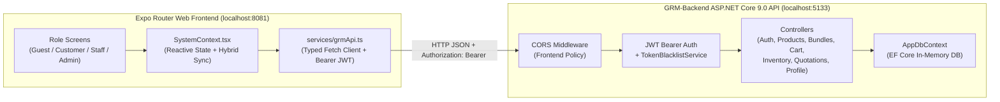

# Step-by-Step Guide: Connecting `GRM-Backend` (ASP.NET Core 9.0 Web API) to the Expo / React Native Web Frontend

This document explains every step taken to connect the **ASP.NET Core 9.0 Web API** (`GRM-Backend/GRM_Backend`) with the **Expo Router + TypeScript Frontend** (`app/`, `context/`, `services/`) for **Garry's Smartlock and Solar Inventory Management System**.

---

## Architecture Overview



---

## Step 1: Inspecting the Backend Ports & Configuration

First, we inspected [launchSettings.json](file:///c:/Users/Jan/GRM/GRM-Backend/GRM_Backend/Properties/launchSettings.json) and [appsettings.json](file:///c:/Users/Jan/GRM/GRM-Backend/GRM_Backend/appsettings.json) to identify how the ASP.NET Core server listens for requests and validates JWTs:

- **HTTP Base URL:** `http://localhost:5133`
- **HTTPS Base URL:** `https://localhost:7217`
- **Swagger UI / OpenAPI Spec:** Served at root (`http://localhost:5133/swagger/v1/swagger.json`)
- **JWT Settings:**
  - `Issuer`: `"GRM_Backend"`
  - `Audience`: `"GRM_Backend"`
  - `ExpirationInMinutes`: `120`
  - Accepts `Authorization: Bearer <token>` header on protected endpoints.

---

## Step 2: Enabling Cross-Origin Resource Sharing (CORS) in `Program.cs`

Because the Expo Web frontend runs on `http://localhost:8081` and the ASP.NET Core Web API runs on `http://localhost:5133`, browsers block cross-origin `fetch()` calls unless the backend explicitly returns `Access-Control-Allow-Origin`, `Access-Control-Allow-Headers`, and `Access-Control-Allow-Methods` headers (including `OPTIONS` preflight requests for `Authorization` and `Content-Type: application/json`).

### Changes made in `GRM_Backend.csproj`:
Added `<RollForward>LatestMajor</RollForward>` so the project targets .NET 9 while seamlessly running on machines that have the .NET 10 SDK/runtime installed (`10.0.10` / `10.0.302`).

### Changes made in [Program.cs](file:///c:/Users/Jan/GRM/GRM-Backend/GRM_Backend/Program.cs):

1. **Registered the `"Frontend"` CORS policy** on `builder.Services` ([Program.cs](file:///c:/Users/Jan/GRM/GRM-Backend/GRM_Backend/Program.cs#L76-L84)):
   ```csharp
   builder.Services.AddCors(options =>
   {
       options.AddPolicy("Frontend", policy => policy
           .SetIsOriginAllowed(origin => new Uri(origin).IsLoopback) // http://localhost:* / 127.0.0.1:*
           .AllowAnyHeader()
           .AllowAnyMethod());
   });
   ```
2. **Activated the CORS middleware before Authentication/Authorization** ([Program.cs](file:///c:/Users/Jan/GRM/GRM-Backend/GRM_Backend/Program.cs#L204-L209)):
   ```csharp
   app.UseHttpsRedirection();
   app.UseCors("Frontend"); // Must run before UseAuthentication so OPTIONS preflight requests succeed
   app.UseAuthentication();
   app.UseAuthorization();
   ```

---

## Step 3: Seeding Initial Catalog, Bundles & Demo Roles in `Program.cs`

`GRM-Backend` uses `options.UseInMemoryDatabase("GRM_Backend_Db")`, which starts empty every time the backend process restarts. Originally, [Program.cs](file:///c:/Users/Jan/GRM/GRM-Backend/GRM_Backend/Program.cs) only seeded `Admin` (`admin@grm.local` / `Admin123!`) and `Staff` (`staff@grm.local` / `Staff123!`).

We expanded the startup seed block in [Program.cs](file:///c:/Users/Jan/GRM/GRM-Backend/GRM_Backend/Program.cs#L146-L181) to also seed:
1. **Default Customer Account:**
   - `customer@grm.local` / `Customer123!` (`Role = "Customer"`, `FullName = "Maria Santos"`)
2. **Products & Variant-Level SKUs:**
   - **Garry SmartLock** (`Smart Locks`): `SL-PIN-01` (₱5,990, stock 24), `SL-BIO-01` (₱9,490, stock 12), `SL-CRD-01` (₱7,250, stock 9)
   - **Monocrystalline Solar Panel Set** (`Solar Panels`): `SP-S-02` (₱18,500, stock 15), `SP-M-04` (₱34,900, stock 10), `SP-L-07` (₱62,000, stock 6)
   - **LiFePO4 Solar Battery** (`Batteries`): `BT-05` (₱48,000, stock 8), `BT-10` (₱89,000, stock 5)
3. **Composite Solar Bundles:**
   - **Small Solar + Battery Kit** (`₱62,000`): `1× SP-S-02` + `1× BT-05`
   - **Medium Solar + Battery Kit** (`₱119,000`): `1× SP-M-04` + `1× BT-10`
   - **Large Solar + Battery Kit** (`₱225,000`): `1× SP-L-07` + `2× BT-10`

---

## Step 4: Allowing Storefront Bundle Listing & Quotation Stock Deduction on the Backend

1. **Public Bundle Listing ([BundlesController.cs](file:///c:/Users/Jan/GRM/GRM-Backend/GRM_Backend/Controllers/BundlesController.cs#L39-L43)):**
   `BundlesController` had `[Authorize(Roles = "Admin")]` at the controller level, which prevented Guests and Customers from viewing composite bundles on the storefront. We added `[AllowAnonymous]` to `[HttpGet]` while keeping `POST`, `PUT`, and `DELETE` restricted to `Admin`.
2. **Stock Deduction on Quotation Conversion ([QuotationsController.cs](file:///c:/Users/Jan/GRM/GRM-Backend/GRM_Backend/Controllers/QuotationsController.cs#L346-L362)):**
   In `POST /api/quotations/{id}/convert`, when an `Accepted` quotation is converted into a `SalesOrder`, the backend now decrements `Variant.Stock` for each quoted line item and writes an audit record to `StockMovements` (`Type = "StockOut"`).

---

## Step 5: Creating the Typed Frontend API Service (`services/grmApi.ts`)

We created [services/grmApi.ts](file:///c:/Users/Jan/GRM/services/grmApi.ts) as a clean, zero-dependency TypeScript HTTP client around `fetch()` targeting `http://localhost:5133` (or `process.env.EXPO_PUBLIC_API_URL` if set).

### Key Responsibilities of `services/grmApi.ts`:
- **JWT Bearer Management:** Stores the active token via `setApiToken(token)` and automatically attaches `Authorization: Bearer <token>` to every request.
- **Structured Error Unwrapping:** Parses ASP.NET Core `MessageResponse` (`{ message: "..." }`) and validation problem payloads so backend validation rules (e.g., `"Staff members may not apply a discount greater than 10%."` or `"Insufficient stock."`) surface directly in the UI banner.
- **Complete Endpoint Coverage:**

| Domain | Frontend Method in `grmApi` | Backend HTTP Route | Role |
| :--- | :--- | :--- | :--- |
| **Auth** | `grmApi.auth.login(emailOrUsername, password)` | `POST /api/auth/login` | Public |
| **Auth** | `grmApi.auth.register(payload)` | `POST /api/auth/register` | Public |
| **Auth** | `grmApi.auth.logout()` | `POST /api/auth/logout` | Authenticated |
| **Auth** | `grmApi.auth.me()` | `GET /api/auth/me` | Authenticated |
| **Profile** | `grmApi.profile.get()` / `update(payload)` | `GET, PUT /api/profile` | Customer |
| **Catalog** | `grmApi.products.list({ search, category, page, pageSize })` | `GET /api/products` | Public / Admin |
| **Catalog** | `grmApi.products.create()` / `update()` / `setStatus()` | `POST, PUT, PATCH /api/products` | Admin |
| **Variants** | `grmApi.products.addVariant()` / `updateVariant()` | `POST /api/products/{id}/variants`, `PUT /api/variants/{id}` | Admin |
| **Bundles** | `grmApi.bundles.list()` / `create()` / `update()` / `remove()` | `GET, POST, PUT, DELETE /api/bundles` | Public (`GET`) / Admin |
| **Cart** | `grmApi.cart.get()` / `addItem()` / `updateItem()` / `removeItem()` / `clear()` | `/api/cart`, `/api/cart/items/{variantId}` | Customer |
| **Inventory** | `grmApi.inventory.getAll()` / `lowStock()` / `movements()` | `GET /api/inventory`, `/low-stock`, `/movements` | Staff, Admin |
| **Inventory** | `grmApi.inventory.stockIn()` / `stockOut()` / `adjust()` | `POST /api/inventory/stock-in`, `/stock-out`, `/adjustments` | Staff, Admin (`adjust` = Admin) |
| **Quotations** | `grmApi.quotations.requestQuote(items, notes)` | `POST /api/quotations/requests` | Customer |
| **Quotations** | `grmApi.quotations.create()` / `update()` / `send()` / `convert()` | `POST, PUT /api/quotations/{id}`, `/send`, `/convert` | Staff, Admin |
| **Quotations** | `grmApi.quotations.getMy()` / `accept()` / `decline()` | `GET /api/quotations/my`, `POST /accept`, `/decline` | Customer |
| **Quotations** | `grmApi.quotations.pdfUrl(id)` | `GET /api/quotations/{id}/pdf` | Customer, Staff, Admin |

---

## Step 6: Wiring `SystemContext.tsx` to `grmApi`

In [context/SystemContext.tsx](file:///c:/Users/Jan/GRM/context/SystemContext.tsx), we connected the reactive context state to `grmApi`:

1. **Initial Mount Synchronization (`syncWithBackend`):**
   - When the app boots, `useEffect` calls `syncWithBackend()`, which fetches `GET /api/products?pageSize=100` and `GET /api/bundles` from `http://localhost:5133`.
   - It links each frontend product, variant (matched by `SKU`), and composite bundle to its database primary key (`backendId`) and updates live prices and `StockCount` values from the ASP.NET Core in-memory database.
   - It sets `apiOnline = true` when `localhost:5133` responds, or gracefully falls back (`apiOnline = false`) if the C# server is not running.
2. **Real JWT Authentication on Login & Role Switching:**
   - Logging in on [app/login.tsx](file:///c:/Users/Jan/GRM/app/login.tsx) or clicking any role in the top-bar **Role Switcher Pill** ([components/TopBar.tsx](file:///c:/Users/Jan/GRM/components/TopBar.tsx)) calls `POST /api/auth/login` against `GRM-Backend` using the seeded role credentials (`admin@grm.local`, `staff@grm.local`, `customer@grm.local`), stores the real JWT token via `setApiToken(res.token)`, and re-syncs the catalog.
3. **Two-Way Mutation Sync:**
   - **Cart Actions:** Adding/updating/clearing items as a Customer calls `POST /api/cart/items`, `PUT /api/cart/items/{variantId}`, and `DELETE /api/cart`.
   - **Quotation Lifecycle:**
     - Customer requesting a quote calls `POST /api/quotations/requests` and stores the returned `backendId`.
     - Staff preparing and sending the quote calls `PUT /api/quotations/{id}` (which enforces the backend `StaffMaxDiscount = 10%` check) followed by `POST /api/quotations/{id}/send`.
     - Customer accepting the quote calls `POST /api/quotations/{id}/accept` and `POST /api/quotations/{id}/convert`, creating the backend `SalesOrder` and deducting variant stock.
   - **Sales & Stock Movements:**
     - Online checkouts, walk-in POS sales, manual Stock-In/Stock-Out logs, PO stock receiving, and Admin stock overrides call `POST /api/inventory/stock-in`, `POST /api/inventory/stock-out`, and `POST /api/inventory/adjustments` on `GRM-Backend`, keeping backend variant stock counts and `StockMovements` synchronized.
   - **Catalog CRUD:**
     - Creating or updating Products, Variants, and Bundles in `Admin > Products` calls `POST/PUT /api/products`, `POST /api/products/{id}/variants`, `PUT /api/variants/{id}`, and `POST/PUT /api/bundles`.

---

## Step 7: Live API Status Indicator in `TopBar.tsx`

In [components/TopBar.tsx](file:///c:/Users/Jan/GRM/components/TopBar.tsx#L46-L70), we added a live connection status pill in the top navigation bar:
- **Green (`API: 5133 Connected`):** Indicates the frontend is actively communicating with `http://localhost:5133`.
- **Amber (`API: Local Fallback`):** Shown if the C# server is stopped; clicking the pill triggers `syncWithBackend()` to reconnect immediately once the backend is started.

---

## How to Run Both Servers Together

### Terminal 1 — Start the ASP.NET Core Backend (`http://localhost:5133`)
```powershell
cd c:\Users\Jan\GRM\GRM-Backend\GRM_Backend
dotnet run --launch-profile http
```
- Swagger UI will be available at: `http://localhost:5133`
- Seeded Backend Credentials:
  - **Admin:** `admin@grm.local` / `Admin123!`
  - **Staff:** `staff@grm.local` / `Staff123!`
  - **Customer:** `customer@grm.local` / `Customer123!`

### Terminal 2 — Start the Expo Web Frontend (`http://localhost:8081`)
```powershell
cd c:\Users\Jan\GRM
npx expo start --web --port 8081
```
- Open `http://localhost:8081` in your browser.
- The top bar will show **`API: 5133 Connected`** in green.

